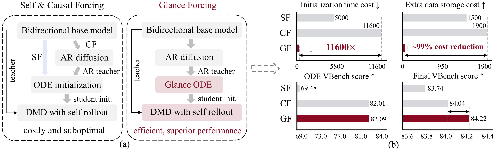

# Glance Forcing: One Sample Forcing Model

Official PyTorch implementation of the paper:

**Glance Forcing: Making Bidirectional Diffusion Autoregressive at a Glance**
<br>
<!-- In ECCV 2026 -->
<!-- <br> -->
[Zhuobai Dong](https://zhuobaidong.github.io/)<sup>1</sup>, 
[Junchao Yi](https://github.com/Junc1i)<sup>2</sup>,
[Hu Jian Guo](https://ieeexplore.ieee.org/author/37536384400)<sup>3</sup>,
[Linjie Li](https://scholar.google.com/citations?user=WR875gYAAAAJ&hl=en)<sup>4</sup>,
[Alex Jinpeng Wang](https://fingerrec.github.io/)<sup>5</sup>
[Rui Zhao](https://ruizhaocv.github.io/)<sup>6</sup>
<br>
<sup>1</sup>WuHan University, <sup>2</sup>University of Electronic Science and Technology of China, <sup>3</sup>Sun Yat-sen University, <sup>4</sup>University of Washington, <sup>5</sup>Central South University, <sup>6</sup>National University of Singapore
<br>
[ArXiv](https://arxiv.org/abs/2512.02899) | [Homepage](https://zhuobaidong.github.io/Glance-Forcing/) | [Model🤗](https://huggingface.co/CSU-JPG/Glance)



# 🔥 News
- **2026.10.15** : The [paper](https://arxiv.org/abs/2602.02214), [project page](https://thu-ml.github.io/CausalForcing.github.io/), and code are released.

# Quick Start

### Installation
```bash
conda create -n glance_forcing python=3.10 -y
conda activate glance_forcing
pip install -r requirements.txt
pip install git+https://github.com/openai/CLIP.git
pip install flash-attn --no-build-isolation
python setup.py develop
```
### Download Checkpoints
```bash
hf download Wan-AI/Wan2.1-T2V-1.3B  --local-dir wan_models/Wan2.1-T2V-1.3B
hf download Wan-AI/Wan2.1-T2V-14B  --local-dir wan_models/Wan2.1-T2V-14B
# glance forcing
hf download CSU-JPG/Glance-Forcing ar_diffusion.pt --local-dir checkpoints
hf download CSU-JPG/Glance-Forcing Glance-Forcing/slow_lora.pt --local-dir checkpoints
hf download CSU-JPG/Glance-Forcing Glance-Forcing/fast_lora.pt --local-dir checkpoints
# one-sample model
hf download CSU-JPG/Glance-Forcing Glance-Forcing-one_sample/slow_lora.pt --local-dir checkpoints
hf download CSU-JPG/Glance-Forcing Glance-Forcing-one_sample/fast_lora.pt --local-dir checkpoints
```
### Inference
```bash
python inference.py \
  --config_path configs/dmd.yaml \
  --output_folder output \
  --checkpoint_path checkpoints/ar_diffusion.pt \
  --slow_lora checkpoints/Glance-Forcing/slow_lora.pt \
  --fast_lora checkpoints/Glance-Forcing/fast_lora.pt \
  --data_path prompts/demos.txt
```

Or try our one-sample model
```bash
python inference.py \
  --config_path configs/dmd.yaml \
  --output_folder output \
  --checkpoint_path checkpoints/ar_diffusion.pt \
  --slow_lora checkpoints/Glance-Forcing-one_sample/slow_lora.pt \
  --fast_lora checkpoints/Glance-Forcing-one_sample/fast_lora.pt \
  --data_path prompts/demos.txt
```

# Training

<details>
<summary> Stage 1: Autoregressive Diffusion Training (Can skip by using pretrained checkpoints. Click to expand.)</summary>

First download the dataset:
```bash
hf download zhuhz22/Causal-Forcing-data  --local-dir dataset
python utils/merge_and_get_clean.py
```
> If the download gets stuck, Ctrl^C and then resume it.

Then train the AR-diffusion model:
  ```bash
    torchrun --nnodes=8 --nproc_per_node=8 --rdzv_id=5235 \
    --rdzv_backend=c10d \
    --rdzv_endpoint $MASTER_ADDR \
    train.py \
    --config_path configs/ar_diffusion_tf_chunkwise.yaml \
    --logdir logs/ar_diffusion
  ```
</details>

<details>
<summary> Stage 2: Glance ODE Initialization (Can skip by using our pretrained checkpoints. Click to expand.)</summary>

In this stage, first generate slow-fast ODE paired data:
```bash

torchrun --nproc_per_node=8 \
  get_slowfast_ode_data.py \
  --generator_ckpt checkpoints/ar_diffusion.pt \
  --rawdata_path /mnt/lmdb \
  --output_folder dataset/slowfast_ODE_latents \
  --num_frames_per_chunk 3
  --generation_mode blockwise_kv

python utils/create_lmdb_iterative.py \
  --data_path dataset/slowfast_ODE_latents  \
  --lmdb_path dataset/slowfast_ODE
```

Or you can also directly download our toy dataset:
```bash
hf download zhuobai/slow-fast --repo-type dataset --local-dir dataset
```
> If the download gets stuck, Ctrl^C and then resume it.


And then train Glance ODE initialization models:
  ```bash
  torchrun --nnodes=8 --nproc_per_node=8 --rdzv_id=5235 \
    --rdzv_backend=c10d \
    --rdzv_endpoint $MASTER_ADDR \
    train.py \
    --config_path configs/glance_ode.yaml \
    --logdir logs/glance/{slow_lora,fast_lora}
  ```

Inference to test training results:

```bash
python inference.py \
  --config_path configs/glance_ode.yaml \
  --output_folder output/glance_ode \
  --checkpoint_path checkpoints/ar_diffusion.pt \
  --slow_lora checkpoints/Glance_ODE/slow_lora.pt \
  --fast_lora checkpoints/Glance_ODE/fast_lora.pt \
  --data_path prompts/demos.txt
```

</details>

<details>
<summary>
Stage 3: DMD
</summary>

First download the dataset:
```bash
hf download gdhe17/Self-Forcing vidprom_filtered_extended.txt --local-dir prompts
```

```bash
hf download CSU-JPG/Glance-Forcing Glance-ODE/slow_lora.pt --local-dir checkpoints/Glance-ODE
hf download CSU-JPG/Glance-Forcing Glance-ODE/fast_lora.pt --local-dir checkpoints/Glance-ODE
```

And then train DMD models:
  ```bash
  torchrun --nnodes=8 --nproc_per_node=8 --rdzv_id=5235 \
    --rdzv_backend=c10d \
    --rdzv_endpoint $MASTER_ADDR \
    train.py \
    --config_path configs/dmd.yaml \
    --logdir logs/glance_forcing/{slow_lora,fast_lora}
  ```
> For bs8, we recommend training for no more than 8K steps; otherwise the motion dynamics may degrade.

Such models are the final models used to generate videos.

</details>

# Acknowledgements
This codebase is built on top of the open-source implementation of [CausVid](https://github.com/tianweiy/CausVid), [Self Forcing](https://github.com/guandeh17/Self-Forcing), [Causal Forcing](https://github.com/thu-ml/Causal-Forcing) and the [Wan2.1](https://github.com/Wan-Video/Wan2.1) repo. 

# References
If you find the method useful, please cite
```
@article{zhu2026causal,
  title={Causal Forcing: Autoregressive Diffusion Distillation Done Right for High-Quality Real-Time Interactive Video Generation},
  author={Zhu, Hongzhou and Zhao, Min and He, Guande and Su, Hang and Li, Chongxuan and Zhu, Jun},
  journal={arXiv preprint arXiv:2602.02214},
  year={2026}
}
```
